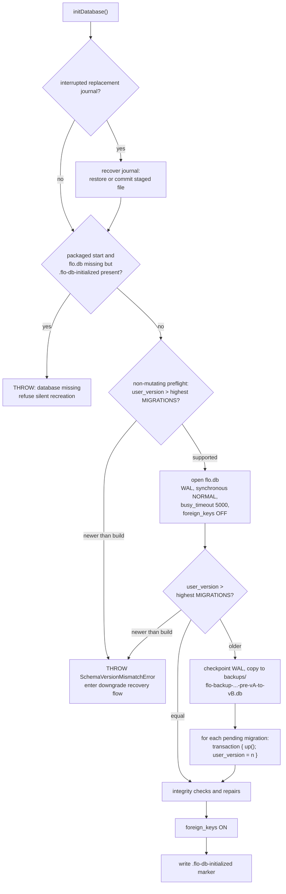

# Data and migrations

FloCafe stores everything in one SQLite file managed with `better-sqlite3`. Schema change is
append-only and versioned. This page covers where the file lives, how a version becomes a
migration, what protects customer data on the way, and how to verify all of it.

The code is [`main/db.ts`](../../main/db.ts). It is large and owns more than the schema; the
sections below are the parts a contributor needs in order to change it safely.

## Database location

`getDbPath()` resolves the file in this order:

1. `FLO_E2E_DB_PATH`, resolved to an absolute path, when set. The native Playwright suites use this
   to point at a disposable database; it has no effect on a normal install.
2. `app.getPath('userData')` in a packaged build.
3. The project root in an unpackaged run, computed from the compiled output location.

The file is named `flo.db`. The backup directory is `backups/` under `userData`, and the
first-start marker is `.flo-db-initialized` under `userData`.

## Connection pragmas

`initDatabase()` opens the file and sets, in order:

| Pragma | Value | Why |
| --- | --- | --- |
| `journal_mode` | `WAL` | readers do not block the writer, which matters because three servers read concurrently. |
| `synchronous` | `NORMAL` | the durability trade that WAL mode is chosen for. |
| `busy_timeout` | `5000` | wait rather than fail when another connection holds a write lock. |
| `foreign_keys` | `OFF`, then `ON` | disabled across the migration batch, re-enabled immediately after. |

A WAL database has sidecar `-wal` and `-shm` files. Anything that copies the live database, including
the pre-migration backup, checkpoints with `wal_checkpoint(TRUNCATE)` first so the copy is
self-contained.

## The migration registry

`MIGRATIONS` in [`main/db.ts`](../../main/db.ts) is the exported, append-only array of
`{ version, name, up }` entries. Its order and version numbers are the persisted schema contract
for installed databases. The registry is the source for the current entry count, latest version,
and migration names.

Two rules follow from the array being the registry:

- **Never renumber, reorder, or remove an entry.** The version number is the persisted contract with
  every install that has already run it.
- **Never edit a shipped `up`.** It has already run on real databases. A new entry is the only way
  to change the schema.

`getCurrentSchemaVersion()` reads `PRAGMA user_version`, and that pragma is the single source of
truth. It is not inferred from the tables, and it is not tracked in a separate settings row.

## The two fail-closed rules

Startup refuses to open the database directly in two situations, and both exist to protect customer
data:

1. **A missing database on a previously initialized install.** If this is a packaged start, the
   database file is absent, and `.flo-db-initialized` exists, `initDatabase` throws rather than
   creating a fresh empty file. A silently recreated empty database would look like a working POS
   with no orders. The error tells the user to restore from a backup. A genuinely fresh install has
   no marker and proceeds normally.
2. **A database newer than the build.** Before opening `flo.db` read-write, `initDatabase` inspects
   `user_version` without mutating `flo.db` or its `-wal` and `-shm` sidecar files (replaying any
   present sidecars in a temporary copy), and `runMigrations` enforces the same guard. When
   `user_version` exceeds `getLatestSupportedSchemaVersion()`, `SchemaVersionMismatchError` is
   thrown. An older build never reverse-migrates or opens a newer schema directly.

   `initialize()` in [`main/index.ts`](../../main/index.ts) intercepts `SchemaVersionMismatchError`
   before the generic startup-error dialog, quiesces database access, and runs
   `runDowngradeRecoveryFlow` ([`main/downgrade-recovery.ts`](../../main/downgrade-recovery.ts)). The
   recovery flow compares the database schema version (and recorded app version when available)
   against the running build and offers four actions:

   - **Get Latest Version** - opens `FLOCAFE_RELEASES_URL` in the system browser and exits with code
     `0` without modifying any files.
   - **Open Backups Folder** - opens `backups/` in the file manager via `shell.openPath` and returns
     to the recovery dialog.
   - **Restore Compatible Backup** - calls `discoverDowngradeBackups()`, which inspects candidate
     `.db` files in `backups/` by SQLite content (`PRAGMA integrity_check`, `_flo_meta`,
     `PRAGMA user_version`, foreign keys, core tables, and inventory ledger) rather than trusting
     filenames, and lists candidates with `schemaVersion <= getLatestSupportedSchemaVersion()`. When
     no compatible valid backup exists, the dialog reports whether backups are missing, require a
     newer FloCafe version, or failed validation, while keeping update, folder-open, and exit
     actions available. Restoring a selected backup requires explicit confirmation warning that
     orders, payments, inventory changes, and settings recorded after that backup are absent from
     the restored database and stating the archive path
     (`backups/flo-preserved-newer-v<version>-<timestamp>.db`). Cancelling aborts without touching
     any files. On confirmation, `restoreCompatibleBackupForDowngrade` preserves `flo.db` and any
     `-wal` and `-shm` sidecars in `backups/`, records a replacement journal so an interrupted or
     failed restore rolls `flo.db` and its sidecars back cleanly, migrates an older compatible
     backup forward to the supported schema, clears pairing tokens and Google Drive bindings,
     repairs sequences, and resumes normal `initialize()` startup.
   - **Exit** - runs cleanup and exits with code `0` without modifying any files.

## The automatic pre-migration backup

Before any pending batch runs, `syncBackupBeforeMigration` writes a snapshot into
`backups/flo-backup-<timestamp>-pre-v<from>-to-v<to>.db`. On a brand-new install, where no source
file exists yet, it still creates the file so the backup contract holds, and stamps it with the
pre-migration version.

The snapshot is a real SQLite file, not a raw copy alone. It is reopened, switched to
`journal_mode = DELETE` so it is portable away from WAL, and given an `_flo_meta` table recording
`schema_version` and `backup_created_at`, with `user_version` set to the pre-migration value.

`getBackupDir()` always points at `userData`, even in an unpackaged run, so backups never accumulate
inside the repository.

## Startup integrity work

After migrations and with `foreign_keys` re-enabled, startup runs:

- `runStartupIntegrityCheck` - `PRAGMA integrity_check` and `PRAGMA foreign_key_check`. A failed
  integrity check is recorded in `dbHealthError`, which is what the health endpoints report; it
  does not by itself abort startup.
- `repairSequences` - verifies sequence counters to prevent unique-constraint numbering collisions.
  Ordinary boots skip scanning historical orders and bills when sequences are already initialized;
  when repair is pending (such as after migration or restore) or sequences are missing, in-database
  SQL aggregation re-seeds high-water counters for canonical daily formats (`ORD-YYYYMMDD-NNNN` and
  `INV-YYYYMMDD-NNNN`) without materializing historical rows in memory. Custom numbering prefixes and
  non-daily reset periods are tracked dynamically.
- `autoRepairPaymentDetails` and `autoRepairDefaultPrinter` - the two targeted data repairs.

## Order and bill numbers

`generateOrderNumber` and `generateBillNumber` in `main/db.ts` draw from the `sequences` table
(`name`, `date` bucket) and format `[prefix-][date-or-period-]NNNN`. `orders.order_number` and
`bills.bill_number` are `UNIQUE`, so two rules keep every number issuable:

- A series that resets (daily orders; daily, monthly, or financial-year bills) always carries its
  date or period, whatever the include toggle says; only a non-resetting series may omit it. The
  `PUT /api/settings/order-numbering` route stores the effective flag, and `GET` reports it, so the
  settings screen shows the include toggle only for a non-resetting series.
- A candidate that is already issued (a mid-day setting change, a reused prefix, restored or
  imported rows) lifts the counter past the highest number issued under the same head instead of
  failing the sale. The allocation throws only if three attempts cannot find a free number.

## Backup and restore

| Operation | Entry point | Notes |
| --- | --- | --- |
| Create a backup | `createBackup(targetPath?, signal?, options?)` | Runs under the database maintenance lock, so it cannot overlap another backup, restore, or wipe. Returns the path and the schema version. |
| List backups | `listBackups(options?)` | Reports file name, path, size, creation time, `manual` or `auto` kind, and the schema version when readable. Supports cursor pagination (`limit`, `cursor`) via `listBackupsPage()`. |
| Discover downgrade backups | `discoverDowngradeBackups()` | Validates `.db` files in `backups/` by SQLite content and integrity, classifying compatible (`<= getLatestSupportedSchemaVersion()`), newer-incompatible, and corrupt/invalid candidates. |
| Restore a backup | `restoreBackup(backupPath, forceDirect?, signal?)` | Also under the maintenance lock. |
| Restore compatible backup on downgrade | `restoreCompatibleBackupForDowngrade(backupPath, options?)` | Under the maintenance lock; preserves the newer database and `-wal`/`-shm` sidecars in `backups/` and replaces `flo.db` via the replacement journal. |

Backup, restore, and wipe are serialised by one lock. Two of them running at once is the failure
mode that corrupts a database, so any new entry point in this area must take the same lock.

`restoreBackup` reads the `_flo_meta` stamp and the `user_version` pragma from the backup and
decides between a direct file replacement and a data-only restore from the metadata. An unreadable
source returns a structured failure with both versions rather than throwing. Both restore paths
validate inventory ledger movement chains in durable append order (`id` ASC), execute
`executeSequenceRepair` to re-align sequence counters with restored orders and bills, and mark repair
complete.

### Entry points

Two routes reach `restoreBackup`, and they differ only in how the operator is authorised:

| Route | Authorisation | Use |
| --- | --- | --- |
| `POST /api/db/restore` | Session holding `database.manage`, the typed phrase `RESTORE BACKUP`, and a file the operator picked in the native dialog | Restore from a backup file anywhere on disk. The settings screen and the application menu both land here. |
| `restore-backup` IPC | Master PIN, and for a caller-supplied path a managed-backup check | Restore a managed backup from Backup History. |

The HTTP route never accepts a path the renderer invented. `pick-restore-file` shows the native
dialog in the main process and hands the chosen path to `main/services/restore-file-selection.ts`,
which pairs it with a single-use token (`peekRestoreFileSelection` validates the token during
preflight file-existence and schema-version checks, and `consumeRestoreFileSelection` consumes it
only once those checks pass). A request with no matching outstanding selection is refused, so a
compromised renderer cannot aim the restore at a file of its choosing.

A successful restore keeps the snapshot of what it replaced. `retainRestoreSafetyCopy` stamps
`_flo_meta` onto the replacement-journal snapshot, copies it to
`flo-backup-<timestamp>-pre-restore-v<version>.db`, and prunes to `MAX_RETAINED_RESTORE_SAFETY_COPIES`
(3). It copies rather than renames so the journal keeps pointing at a real file, which is what lets a
crash between the committed journal and cleanup still roll the live database back. Because the copy
carries the `flo-backup-` prefix, it appears in `listBackups()` and is restorable through the same
preset path as any other managed backup, so a restore of the wrong file is an undo rather than data
loss. Retention failure is logged and never fails the committed restore.

### Daily local backup

`main/services/local-backup.ts` writes one backup a day to `Documents/FloCafe/Backups`, outside
`userData`, so it survives a data wipe, a reinstall, and an uninstall. It is on unless
`local_backup_enabled` is `'false'`. A check runs two minutes after startup and then hourly; it calls
`createBackup()` when the newest file is at least 24 hours old, and skips a database with
no orders, products, or customers so an empty install cannot push real backups out of retention.
Files are named `flo-backup-<UTC timestamp with milliseconds>Z.db`; names from older releases
without milliseconds are still recognized. Each file is staged and then hard-linked in under the
first free millisecond name, so a snapshot never replaces an existing backup. Only names matching that pattern are listed or pruned. Files dated
ahead of the clock rank below every other file because their time cannot be trusted; the file just
written is always kept, and the newest `LOCAL_BACKUP_RETENTION` (5) are kept in total. Failures are
logged and retried on the next check. These files are plain SQLite and unencrypted. They are not part
of `listBackups()`; restore one through `POST /api/db/restore` with the file picker.
`POST /api/db-tools/initialize`, `POST /api/db-tools/currency-reset`, and the `db-initialize` IPC
channel preserve `local_backup_enabled` across the reset and copy their pre-reset backup here
(`retainBackupLocally`) when the setting is on; `restoreBackup()` likewise preserves the live
`local_backup_enabled` setting across a restore.

### Durability

Replacement is journalled, not best-effort. `writeReplacementJournal` writes a temporary file,
`fsync`s it through a writable handle, renames it into place, and then `fsync`s the containing
directory. The journal records a `prepared` or `committed` phase, and
`recoverInterruptedDatabaseReplacement` replays it on the next start: an interrupted replacement
either completes or is rolled back to a `.cleanup-<id>` copy. `isLiveDatabaseTarget` prevents a
replacement from overwriting the live database or a hard link to it.

`syncFile` uses `fs.openSync(path, 'r+')` plus `fs.fsyncSync` so the flush is portable to Windows.
Directory syncing is skipped on Windows, which does not support it.

## Verification commands

| Command | Covers |
| --- | --- |
| `npm run audit:db` | The database audit: schema, data, and consistency checks over the repository's expectations. |
| `npm run test:upgrade-path` | Migration from historical snapshots up to the current version. |
| `npm run test:upgrade-regression` | Regression cover for past migration defects. |
| `npm run test:upgrade-matrix-harness` | The harness the CI upgrade matrix drives. |
| `npm run test:schema-health` | Schema shape, index health, and recovery reference caching. |
| `npm run test:schema-reference-cache` | Recovery schema reference caching and migration registry invalidation. |
| `npm run test:backup` | Backup and restore behaviour. |
| `npm run test:local-backup` | The daily local backup: naming, due logic, retention (including future-dated files), opt-out, empty-database skip, and the Initialize copy warning. |
| `npm run test:sequence` | Order and bill sequence generation, repair performance, and no-reuse invariants. |
| `npm run test:issue-278-fail-closed-db` | The missing-database guard. |
| `npm run test:newer-db-recovery` | Newer-database startup interception, content-based backup discovery, sidecar preservation, journaled downgrade restore, and rollback. |

`isHealthyDatabaseFile` is the predicate that decides whether a candidate file is usable at all. It
requires a clean `integrity_check`, no foreign-key violations outside an explicit allowlist, a
schema version above zero and within the supported range, an `_flo_meta` stamp that matches the
pragma, and a table and column set, plus normalised `CREATE` definitions, that match the ideal
schema built by running the whole migration pipeline in memory (cached across health checks and
invalidated on migration registry changes; runtime-ensured indexes in
`RUNTIME_ENSURED_SCHEMA_OBJECTS` such as `idx_order_items_active_kds` at schema v121+ may be absent
on an unopened file or direct-restore backup and are created on writable open by
`ensureRuntimeIndexes()`, while mismatched definitions or unknown extra objects are still rejected).
`runHealthCheck()` in [`main/services/schema-health.ts`](../../main/services/schema-health.ts)
likewise caches its ideal `DbSchemaSnapshot` in memory and invalidates it when the `MIGRATIONS`
registry identity changes.

## Adding a migration

1. Append a new entry to `MIGRATIONS` with the next version number, a `snake_case` name, and an
   `up` that is safe to run once against a database that has data.
2. Never touch an existing entry.
3. If the change adds a table, a column, or an index that the recovery path needs, verify the
   change is reflected in the expected-schema reference the health predicate uses.
4. Add test vectors that exercise the migration from a populated database, not from empty.
5. Run `npm run test:upgrade-path`, `npm run test:upgrade-regression`, and `npm run test:backup`, and
   run `npm run audit:db`.

## Timestamps

`now()` returns the SQLite `CURRENT_TIMESTAMP` format, `YYYY-MM-DD HH:MM:SS`, in UTC. Read a stored
timestamp with `parseDbTimestamp`, never with a bare `new Date(string)`. See
[Business time](business-time.md).
