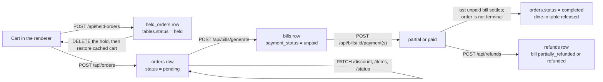

# Order lifecycle

An order is the server's record of a sale in progress. The renderer collects choices - cart lines, a
table, a discount, a tender - and submits them; the API resolves prices, tax, discounts, balances,
and settlement, and the renderer reads the result back. What a customer owes is never decided in the
renderer; the reasoning is in
[0002: backend-authoritative security and tax](../decisions/0002-backend-authoritative-security-and-tax.md).



The endpoint tables, authorization gates, and rate limits are in the
[API reference](../reference/api.md); this page explains how the stages fit together and where each
boundary fails.

## Cart and held carts

A held cart is a snapshot of the renderer's cart, not an order. `POST /api/held-orders` stores it in
`held_orders` and marks the table `held`; nothing is priced, stock is not touched, and no kitchen
ticket exists. A table holds at most one cart: posting again for the same table replaces the stored
row, returning a new `ho-` id.

The POS resume path is [`frontend/src/store/held-orders.ts`](../../frontend/src/store/held-orders.ts)
plus the POS page at `frontend/src/app/(dashboard)/pos/page.tsx`: the store deletes the persisted
hold before returning its cached cart, which the page then loads into the renderer for checkout.
Order creation happens later. If checkout or order creation fails after the restore, the hold is
already gone and the cart remains only in renderer memory. The held-order API reference describes
the delete guard and table update.

Cart decisions travel with the hold as ids (`waivedChargeIds`, `optedInChargeIds`) and are handed to
the charges engine when the order is created, which stays authoritative about which of them apply.

## Creating the order

`POST /api/orders` in [`main/routes/orders.ts`](../../main/routes/orders.ts) is the pricing entry
point. It requires 1 to 200 items and a `type` of `dine_in`, `takeaway`, `delivery`, or `online`, and
accepts a table, customer, guest count, notes, manual charge amounts, cart charge choices, and the
delivery-only fields documented in the API reference.

Everything monetary is resolved server-side inside one transaction:

- The unit price comes from the catalog: `products.price`, or the variant price for an order with an
  `online_platform`. A client-sent price is never read.
- A product that is switched off or deleted is refused with `400` (`assertProductOnMenu()` in
  [`main/routes/orders-validation.ts`](../../main/routes/orders-validation.ts)). Adding items, a
  quantity increase, and a replacement apply the same check; a quantity reduction, a void, a
  refund, and a [recipe-only or note-only edit](#recipes-on-pizza-and-deal-lines) of a line
  already sold do not.
- A line's amount is its unit price plus its add-ons, times the quantity, less its item discount,
  worked out in decimal arithmetic and rounded half-up to the currency's decimal places
  (`lineSubtotal()` in [`main/services/tax.ts`](../../main/services/tax.ts)). Order creation, added
  items, item edits, item discounts, price overrides, and the tax preview all use it, so the tax
  engine is given the same whole-cent amount on every path. The order subtotal is the rounded sum
  of its lines.
- A percentage or flat discount is worked out by `discountOn()` in the same file: in decimal
  arithmetic, rounded half-up, never more than its base. The item, order, and bill discount
  routes, the recalculation after an order or a line changes, and the tax preview all use it.
  `calculateOrderTotals()` in [`main/services/orders.ts`](../../main/services/orders.ts) rounds
  each stored line subtotal to the currency before adding the lines up, so a line stored as
  `32.099999999999994` is discounted and taxed as `32.10`.
- A client may send `expected_subtotal`, the amount it showed for the lines of the request before
  tax, order discounts, and charges. `assertExpectedSubtotal()` in
  [`main/pizza/price-guard.ts`](../../main/pizza/price-guard.ts) compares it with the sum of the
  line amounts above and refuses the request with `409` and `code: "PRICES_CHANGED"` ("Prices have
  changed. Check the order and place it again.") when they differ by a cent or more. The check
  throws inside the route's transaction, which rolls back: no order, line, stock movement, or
  audit row stays, and nothing is sent to the kitchen. Adding items applies the same check to the
  lines it adds. A request without the field is priced as it always was, which is what the Server
  App, the Orders page, and other API clients send.
- The POS sends the field on every order it creates and every cart it adds to an order
  (`cartExpectedSubtotal()` in
  [`frontend/src/lib/pizza/price-guard.ts`](../../frontend/src/lib/pizza/price-guard.ts)): unit
  price, or the owner's override, or the platform price of an online order, plus add-ons, times
  quantity, each line rounded as `lineSubtotal()` rounds it. The cart's subtotal and line amounts
  are the same calculation (`cartLinesTotal()` in
  [`frontend/src/lib/cart-price.ts`](../../frontend/src/lib/cart-price.ts)), so 1.5 kg at 1.13
  shows and sends 1.70; while it adds to an order the cart shows that order's prices, its
  platform's when it has one. The cart holds no item discount. The guard compares totals, not
  lines, so price changes that cancel out pass it.
- A retry of an order request sends the request its idempotency key was first sent with: the
  stored attempt keeps the lines and the amount quoted
  ([`frontend/src/lib/pizza/quoted-retry.ts`](../../frontend/src/lib/pizza/quoted-retry.ts)), and a
  cart that differs from it only in add-on prices and the quote is the same order. So a create
  whose answer was lost is answered from the order it placed, never placed again under a new key,
  and a request that never arrived is refused for its old quote. A reload replays a stored
  add-items request with its quote; when that is refused its lines go back to an empty cart, on
  the order they were for.
- On the refusal the POS shows the message, fetches the pizza menu, products, and categories again,
  and prices the cart from the fresh products with every line kept; a line whose product, size, or
  add-on is no longer listed keeps its old price and is marked "Not on the menu". The cashier
  places the order again. A published pizza menu re-prices and marks the cart the same way when
  its lists reach the page, and in a shop with a pizza menu a refusal of a product, size, or
  add-on that is no longer on sale fetches the lists too.
- An item discount and an order discount of the same percentage can differ by a cent in tax: an
  item discount taxes the discounted line, while an order discount prorates tax that was already
  rounded per line (1.52 against 1.53 on three at 10.70 with 5% off and 5% tax).
- Quantity rules are checked per sale unit, including fractional and weight-precision products.
- Stock deduction and recipe depletion are written in the same transaction for immediate orders
  (scheduled orders defer stock and recipe depletion until kitchen release), so the order and its
  inventory effects commit together.
- Each line's tax is computed by the tax engine ([Taxation](taxation.md)) and stored on the line as
  `tax_amount`, `tax_breakdown`, `tax_snapshot`, and `tax_type`.
- The charges engine decides which configured charges apply, honouring the cart's waived and
  opted-in ids. Standard ids are projected onto the order's `packaging_charge` and `service_charge`
  columns; non-standard charges are added to the total. The snapshot rules are in
  [product invariants](../reference/product-invariants.md#applied-charge-snapshots-stay-with-existing-orders).
- The total is the discounted subtotal plus exclusive tax plus delivery, packaging, service, and
  other charges, rounded to the currency's decimal places. A total whose minor-unit
  value would leave the safe-integer range is rejected instead of being stored lossily.

Order numbers are allocated inside the transaction. Request replay follows the
[order API idempotency contract](../reference/api.md#orders).
The order starts `pending` with its totals snapshotted, and a `dine_in` order with a table marks the
table `occupied`.

## Recipes on pizza and deal lines

A pizza, a half and half, or a deal carries its recipe in the line's `modifier_selection`: the
ingredients left off, the two halves, or a deal's pizzas, drinks, and wing flavour.
`checkLineRecipe()` in [`main/pizza/order-recipe.ts`](../../main/pizza/order-recipe.ts) checks every
incoming line of `POST /api/orders`, `POST /api/orders/:id/items`, and
`PATCH /api/orders/:orderId/items/:itemId/edit`, inside the transaction that writes the line:

- `pizza_products` says whether the line's product is a pizza, the half-and-half product, or a
  deal. A product with no row there keeps whatever `modifier_selection` it sends, except that an
  object whose `kind` is `pizza` or `deal` is refused.
- A pizza product and the half-and-half product need a size variant on the line; a line without
  one is refused with "Pick a size for this pizza".
- A pizza product may arrive with no recipe. The half-and-half product and every deal product
  require one.
- `validateRecipe()` in [`shared/pizza/recipe.ts`](../../shared/pizza/recipe.ts) checks the recipe
  against the catalogue stored in `pizza_menu` and returns the form that is stored: removed
  ingredients, extras, and added toppings sorted with repeats dropped and an empty list of extras
  or toppings left out, pop counts sorted with zero counts dropped. A recipe of more than 28,000
  bytes of JSON in UTF-8 is refused.
- The recipe has to agree with the line. The variant id is the product id, a hyphen, and the
  recipe's `sizeId`. `whole` names the pizza product's own menu id and never appears on the
  half-and-half product; `halves` appears only there. `dealId` is the deal product's menu id.
- A refusal answers `400` with the recipe's message as `error`, and the transaction writes nothing.
- The catalogue is read once per request, and only when a line carries a recipe to check. When the
  `pizza_menu` row is missing or is not valid JSON, such a line answers `503` with "The pizza menu
  is not loaded. Load the menu file again." Lines without a recipe are not affected.
- A recipe never changes a price. The unit price is the variant's or product's catalog price, as
  for any other line.
- Extras and added toppings are charged as two add-ons a menu load makes, `ad-topping` for one on
  a whole pizza and `ad-topping-half` for one on a half. `toppingCounts()` in
  [`shared/pizza/toppings.ts`](../../shared/pizza/toppings.ts) says how many of each a recipe
  needs, a deal adding up its pizzas, and `checkLineRecipe()` refuses a line whose summed
  quantities of the two differ from that with "The toppings on this item do not match what it is
  charged. Remove it and add it again". The rule holds for every product, with or without a
  recipe, so the charge can be neither left out nor added by hand. The add-ons are priced by
  `resolveItemAddons()` from the catalog like any other.

Later changes to the line keep the recipe:

- A quantity reduction copies the stored recipe without checking it again. A quantity increase and
  a replacement check it against the current menu.
- A replacement that leaves `modifier_selection` out keeps the recipe stored on the line it
  replaces when the product is unchanged (`keepStoredRecipe()`). A kept pizza recipe takes its
  `sizeId` from the replacement's variant, so changing the size keeps the removals and halves. The
  kept recipe is then checked like any other.
- A replacement that sends `modifier_selection: null` sends no recipe: it clears the recipe of a
  pizza product, and is refused on the half-and-half product and on a deal.
- A replacement that names the line's own product, variant, quantity, and add-ons, and sends no
  `price_override`, changes only the recipe or the note (`changesRecipeOnly()` in
  [`main/pizza/sold-line.ts`](../../main/pizza/sold-line.ts)). The new line is the saved line
  with that recipe or note: `carrySoldLine()` and `soldTax()` copy the unit price, the item
  discount amount, and the tax from the saved row, and the saved add-ons, their prices, and their
  stock deductions are reused as a quantity reduction reuses them. Nothing is worked out from the
  current catalog or by the tax engine, so a menu load, a price override, or a tax change between
  the sale and the edit does not move the line's money, and the edit is accepted when the
  product, its size, or one of its add-ons has since been switched off. Two recipes are the
  same when `recipeKey()` gives them the same key, whatever the order of their keys, removals,
  and pops. Two add-on lists are the same when they name the same add-on ids with the same summed
  quantity, so two rows of one and one row of two are the same; an add-on whose id is not text or
  whose quantity is not a positive whole number makes the list differ. A recipe that differs from
  the saved one, an explicit `null` that clears it included, is checked, beside the saved add-ons
  the new line keeps, against the current menu and needs a product that is still switched on, so it is
  refused for a retired pizza; the saved recipe sent back is not checked. Any other replacement, a new
  size or one more add-on included, is a new sale: priced, taxed, and validated from the current
  catalog. Another number of toppings changes the line's add-ons, so it is such a sale; a recipe
  that needs another number while the add-ons stay as sold is refused.
- A replacement by another product does not carry the recipe over, and a line whose
  `modifier_selection` is not a recipe is replaced by exactly what the request sends.
- The adjustment rows a void and an item refund write copy the line's `modifier_selection`.

Restricted kitchen display payloads carry a line's recipe: `projectKdsItem()` in `main/db.ts`
projects only the recipe fields of `modifier_selection` when it holds a well-formed pizza or deal
recipe, dropping anything else stored with them, and projects `null` otherwise. Every
kitchen display item that holds a recipe, restricted or not, also carries `recipe_lines`: the
kitchen ticket's lines for it, which the display shows under the item name. See
[Item detail lines](printing.md#item-detail-lines).

## Scheduled orders and kitchen release

Takeaway and delivery orders in the main POS (desktop and browser) can defer kitchen release by
supplying `scheduled_for` ("Send to kitchen at") when `scheduled_orders_enabled` is enabled (`false`
by default, configurable in Settings > POS; rejected with `409 SCHEDULED_ORDERS_DISABLED` when
disabled). In the POS interface, kitchen scheduling creation controls are shown when
`scheduled_orders_enabled` is enabled, while the scheduled orders queue remains visible whenever
`scheduled_orders_enabled` is enabled or active scheduled/blocked orders exist. Scheduling is
rejected (`400`) on `dine_in` and `online` orders. The kitchen ticket of a scheduled order prints
the time as [`SCHEDULED <time>`](printing.md#scheduled-time-on-kitchen-tickets).

Scheduling separates kitchen release from order status via four columns on `orders`:

- `scheduled_for`: canonical UTC ISO instant (`YYYY-MM-DDTHH:MM:SS.sssZ`), or `NULL` for immediate
  orders; see [scheduled kitchen release](business-time.md#scheduled-kitchen-release) for store
  timezone entry and daylight-saving rules.
- `release_status`: `'scheduled'`, `'blocked'`, or `'released'` (default `'released'` for immediate
  orders).
- `released_at`: timestamp recorded when the order is released to the kitchen.
- `release_blocked_reason`: actionable message recorded when a release attempt fails validation.

Lifecycle rules before and at release:

- **Creation without early side effects.** Creating an order with `scheduled_for` snapshots all
  quoted items, unit prices, discounts, charges, taxes, and totals immediately, sets
  `release_status = 'scheduled'`, leaves product, variant, add-on, and recipe supply stock
  untouched, suppresses KDS notifications and automatic KOT printing, and excludes the order from
  KDS endpoints, kitchen feeds, customer-display tokens, and `POST /api/printers/print-kot` (`409`).
- **Due sweep and manual release.** [`main/services/scheduled-orders.ts`](../../main/services/scheduled-orders.ts)
  runs a server-owned due sweep every 10 seconds, on server startup, and after system resume
  (`powerMonitor` `resume`). The sweep releases due orders where `release_status = 'scheduled'` and
  `scheduled_for <= now`. Orders in `release_status = 'blocked'` are skipped by automatic sweeps and
  must be retried explicitly via `POST /api/orders/:id/release` after resolving the stock or catalog
  problem. If all existing bills are refunded, release is blocked with reason `refunded`; cancel the
  order and create a replacement if needed. Unexpected release errors during a sweep are isolated
  and transition that order to `release_status = 'blocked'` with an actionable message so sweeps do not stall.
- **Shared transactional release (`releaseScheduledOrder`).** Both automatic sweeps and manual
  release execute the same SQLite transaction with an atomic compare-and-check on `release_status`
  so concurrent sweeps and retries never deduct stock twice, plus an optional `checkPreconditions`
  hook for gating release on payment stage. At release time, every non-terminal item re-validates
  required catalog entries (active product, variant, add-on group rules, and add-ons) and deducts
  product, variant, and add-on stock plus the recipe then in effect (preserving negative recipe
  supply stock) while saving actual `inventory_deducted_quantity` and `recipe_snapshot` values on
  each line. Saved prices, discounts, charges, taxes, and totals are never repriced. If any tracked
  product, variant, or add-on stock is insufficient or a catalog entry is unusable, an inner
  savepoint rolls back partial deductions and atomically sets `release_status = 'blocked'` with
  `release_blocked_reason` (`release_blocked` in `order_audit_log`). On release, `release_status`
  becomes `'released'`, `released_at` is set, KDS updates are broadcast, and configured backend
  automatic KOT printing runs; an already-settled non-refunded order keeps `status = 'pending'` when
  KDS is enabled and active unserved items exist, and becomes `status = 'completed'` (recording
  `completed_at`) immediately when KDS is disabled or no active unserved items remain.
- **Prepayment, edit lock, rescheduling, and cancellation.** Full or partial payment is allowed
  before release without triggering early release, without kitchen-delivery blocking, and without
  marking `orders.status = 'completed'`. Item additions, edits, removals, customer changes, manual
  price overrides, discounts, and bill charge mutations are permitted on a scheduled order only
  before the first payment is recorded (`409` with `SCHEDULED_ORDER_PAID` once paid). Timing-only
  changes (`PATCH /api/orders/:id/schedule` or `POST /api/orders/:id/release`) remain allowed until
  release even after payment and record `schedule_updated` or `order_released` in `order_audit_log`.
  Rescheduling resets `release_status` to `'scheduled'` and clears `release_blocked_reason` for
  orders in `'scheduled'`, while preserving `release_status = 'blocked'` and its reason for held
  orders so only explicit manual release retries release. Cancelling a scheduled order before
  release never restores inventory because none was deducted; cancelling a scheduled order with
  collected funds requires refunding the collected amount in full through `/api/refunds` first (`409`
  with `REFUND_REQUIRED_BEFORE_CANCEL`), preserving bills and audit history.

## Multi-counter ordering (create here, pay there)

FloCafe supports owner-configured multi-counter ordering (`multi_counter_enabled`, disabled by
default). In this workflow, separate physical terminals act as ordering stations, payment cashiers,
or combined stations:

- **Named counters and roles.** The store owner defines counters with roles: `ordering` (create order
  and send to payment), `payment` (manage awaiting payment queue and take tender), or `combined`
  (both standard checkout and send to payment). Each POS terminal selects its active counter,
  remembered locally on that device scoped to the active store.
- **Workflow guidance without ownership gating.** Counter roles guide UI defaults without restricting
  underlying staff permissions: ordering counters default to order building and 'Send to payment';
  payment counters automatically open the shared payment queue and orient the cart CTA toward the
  queue; combined counters retain standard direct checkout while allowing explicit 'Send to payment'.
  Staff can view and act on any order across counters; orders are never ownership-gated.
- **Real orders and bills.** "Send to payment" creates real `orders` and `bills` records, never
  transient held-order JSON. Orders record `dispatch_policy = 'on_payment'` and start in
  `checkout_stage = 'awaiting_payment'`.
- **Supported order types.** Multi-counter checkout is supported for **takeaway and dine-in** orders.
  Delivery and online orders use normal checkout on ordering and combined counters and cannot use
  "Send to payment" (`400`). Takeaway can combine multi-counter checkout and scheduled kitchen
  release.
- **Feature availability.** New deferred tickets require `multi_counter_enabled = 'true'`; otherwise
  creation returns `409` with `MULTI_COUNTER_DISABLED`. Replays of committed requests and actions on
  existing deferred tickets remain available after the feature is disabled.
- **Kitchen suppression prior to release.** Orders with `dispatch_policy = 'on_payment'` set
  `release_status = 'scheduled'` and defer stock deduction, KDS display, active-order heartbeats, and
  automatic KOT printing until full payment is collected.
- **Shared transactional release gate.** When full payment across all bills settles:
  - If unscheduled, the order is atomically released to the kitchen via `releaseScheduledOrder`.
  - If scheduled for a future instant, `checkout_stage` transitions to `'paid'`, while
    `release_status` stays `'scheduled'` until the scheduled instant arrives (or manual release is
    triggered).
  - Manual release (`POST /api/orders/:id/release`) on an unpaid `on_payment` order fails with `409`
    (`ORDER_NOT_PAID`).
  - Prepayment does not bypass kitchen preparation (orders with unserved kitchen items keep
    `orders.status = 'pending'`) and does not clear occupied dine-in tables.
- **Paid-but-blocked tickets.** If catalog preconditions or inventory levels fail at release time
  after payment, the transaction atomically transitions `release_status = 'blocked'` with
  `release_blocked_reason` without reverting the committed payment. The ticket remains clearly
  visible in the payment queue for explicit staff retry after restocking or refund/cancellation.
- **Shared LAN queue and QR ticket identification.** Terminals retrieve tickets via
  `GET /api/orders/awaiting-payment` (cursor-paginated with counts) or lookup by ticket/order number
  via `GET /api/orders/by-ticket/:ticket`. Tickets display a human-readable number and QR code
  (`FLOCAFE-TICKET:<order_number>`), which carries zero authentication or payment authority, and can
  be printed as a thermal ticket slip (`POST /api/printers/print-payment-ticket`).

## Discounts

Three surfaces apply discounts, all gated by the discount permission for their scope and by the same
settings:

| Surface    | Endpoint                                       | Notes                                                                                                                                                                                          |
| ---------- | ---------------------------------------------- | ---------------------------------------------------------------------------------------------------------------------------------------------------------------------------------------------- |
| Order      | `PATCH /api/orders/:id/discount`               | Percentage or flat amount against the item subtotal; split or refunded bills or discounts below collected payments return `409`, and completed or cancelled orders return `400`.               |
| Order item | `PATCH /api/orders/:id/items/:itemId/discount` | One line; split or refunded bills or discounts below collected payments return `409`, and completed or cancelled orders or cancelled, voided, void-adjustment, or refunded items return `400`. |
| Bill       | `POST /api/bills/:id/applyDiscount`            | Recomputes the bill and order; paid bills return `400`, split or refunded bills, completed or cancelled orders, and discounts below collected payments return `409`.                           |

Common rules, enforced in the handlers:

- `discount_mode` selects what is allowed (`percentage` by default; `none` disables discounts, `flat`
  rejects percentage discounts and vice versa).
- `discount_max_percentage` (default 25) and `discount_max_amount` (`0` means no limit) cap the
  value. A discount above the cap is a `400`.
- `discount_requires_approval` requires a manager PIN, and the approving user must itself hold the
  discount permission. When an approver is explicitly supplied (`approver_id`, `manager_id`, or
  `user_id`) on an order, item, or bill discount, PIN verification is restricted to that active user
  without falling back to scanning other managers.
- A percentage discount applies to the fresh item subtotal, and a flat discount is capped at that
  subtotal. Re-applying a discount never compounds on the previous one. When a later item addition,
  edit, discount, price override, cancellation, or restoration, or a customer update changes the
  order subtotal, an existing percentage order discount scales to the new subtotal while a flat
  order discount stays at its fixed amount, capped at the new subtotal.
- Order and bill discounts scale item taxes by the discounted share of the subtotal while keeping
  stored `order_items` taxes un-order-discounted; see
  [Taxation](taxation.md#where-the-amount-came-from).
- Applying a discount to an order that has an unpaid bill re-syncs the bill's totals and balance.
  A zero `discount_value` clears an order discount, and a zero `value` clears a bill discount,
  subject to the bill endpoint's discount-mode checks. The item endpoint requires a positive
  `discount_value`.
- A discount cannot reduce a bill's total below collected payments (`below_collected_funds`,
  `409`). Handlers re-read current order, bill, item, and payment rows inside the database
  transaction lock so that concurrent payments, item edits, or bill splits revalidate against fresh
  state.
- Applying an order or bill discount records an `order_discount_applied` action in
  `order_audit_log` with the authenticated actor, discount details, and the approving manager ID
  when a manager PIN override was used (the raw PIN is never stored).

## Manual item price overrides

The owner (only) can sell one line at a price other than its menu price, including `0` for a
complimentary item. The permission `orders.item.price_override` is owner-only and not configurable.

- `PATCH /api/orders/:id/items/:itemId/price` takes `price` and a required `reason`. The same
  `price_override: { price, reason }` object is accepted on a line when an order is created or items
  are added, and a request from any other role is a `403`.
- The line's `unit_price` becomes the override, rounded half-up to the currency's decimal places. The
  first menu price stays in `original_unit_price` across repeated overrides, and `price_overridden`,
  `price_override_reason`, `price_overridden_by`, and `price_overridden_at` record the change.
  Receipts and bills read `unit_price`, so they show the selling price.
- The backend recomputes item tax, order totals, and an open bill. An existing item discount stays,
  capped at the new line total.
- Overrides are allowed once a line has been sent to the kitchen, because only the price changes.
  They are refused (`409`) once a bill has payments, a split, or a refund, and (`400`) on completed or
  cancelled orders and cancelled or voided lines.
- In the POS the owner sees a price control on each cart line (also when adding items to an open
  order). The normalized override is part of the line's cart identity, so it never merges into a
  menu-price line, survives holding and resuming, and is quoted by `POST /api/tax/preview` through an
  optional per-item `price_override: { price }`. The placed order re-checks the owner permission, so a
  held cart with an override placed by another role is refused with `403`.
- A quantity edit keeps the override flag and menu price on the replacement line; replacing the line
  with a different product or variant starts at that product's menu price.
- Each override records an `item_price_overridden` action in `order_audit_log`.
- `GET /api/reports/price-exceptions` lists overridden, non-cancelled lines whose override time falls
  in the selected store-timezone date range, or in one cash shift's window when `shift_id` is given.
  The dashboard shows them as the price exceptions card with a shift selector.

## Bills

`POST /api/bills/generate` creates the order's bill, or, when a bill already exists in `unpaid`,
`partial`, or `partially_paid` status, re-syncs its totals, discount, tax, and charges from the
order and recomputes `balance` against `paid_amount`. A `paid`, `partially_refunded`, or `refunded`
bill (including a zero-total `paid` bill) is never rewritten by bill generation or order-to-bill
synchronization (`syncUnpaidBillsForOrder`), except for a zero-total `paid` split sibling during
split-bill reallocation. Bills snapshot subtotal, discount, tax, charges, `total`, `paid_amount`,
`balance`, and `payment_status`; payable rounding may add a `round_off` adjustment for packs that
define one.

Order mutations that change the customer (`PATCH /api/orders/:id/customer`) or convert a dine-in
order to takeaway (`PATCH /api/orders/:id/convert-to-takeaway`) re-sync open bills under the same
rules:

- `PATCH /api/orders/:id/customer` requires an active order (`400` on `completed` or `cancelled`),
  refuses changes on a paid scheduled order (`409` with `SCHEDULED_ORDER_PAID`) or once any bill has
  payments, a split, or a refund (`409`), re-evaluates
  non-terminal item taxes for the new customer against each item's saved `tax_snapshot` category,
  behavior, and pack version when taxes are enabled and the customer's tax context (B2B status or
  state code) changes, recomputes order and open-bill totals, and records `customer_updated` in
  `order_audit_log`.
- `PATCH /api/orders/:id/convert-to-takeaway` requires an active `dine_in` order (`400`), refuses
  split, paid, or refunded bills (`409`), re-resolves charges for `takeaway`, rejects conversions
  whose payable total would fall below already-collected payments (`409` with
  `below_collected_funds`), re-syncs open bills, releases the table to `available`, and records
  `converted_to_takeaway` in `order_audit_log`.

A split order can have multiple bills, each with its own payments and balance. An order completes
only once every bill of the order is settled; the API reference documents split eligibility and
limits.

## Payments

`POST /api/bills/:id/payment` takes one payment line; `POST /api/bills/:id/payments` takes up to 100
lines and applies them in a single transaction. Both require the payment permission and read the
same fields:

- `method`: `cash`, `card`, `wallet`, or an active configured method, resolved by name or explicitly
  as `{ method: 'custom', payment_method_id }`. An inactive or unknown method is a `400`.
- `amount`: a number in major units with no more decimal places than the currency allows. A
  single-line payment may omit it to settle the remaining balance; a multi-line batch requires every
  amount.
- `transaction_id`: an external reference scoped to its payment method. Reusing it on another bill is
  a `409`; repeating it for the same method twice in a new multi-line batch is also a `409`, while
  reusing it across methods in that batch is a `400`. Replaying an identical committed payment
  returns the bill without writing again. When `card_transaction_id_required` is `true` (default
  `false`, toggled under Settings → Payment methods), a built-in `card` line without one is a `400`
  with display code `card_transaction_id_required`; custom methods are unaffected. The POS payment
  and prepaid checkout dialogs then ask for the card terminal's number on the card line.
- `notes` (up to 1024 UTF-16 code units); serialized payment-line JSON is limited to 8192 UTF-16
  code units.
- `customer_id`: if neither the bill nor order has a customer, a non-wallet payment may attach one;
  if either already has an associated customer, a different id is a `400`. Wallet payments require a
  customer already associated with the bill or order, with enough points.
- `override_pin`: the manager override described below.
- `approver_id`: when supplying `override_pin`, the selected manager ID (`manager_id` and `user_id`
  remain compatibility aliases).

Non-cash lines can never exceed the balance (`400`). Cash is applied up to the amount still owed and
the difference is recorded as change, so an over-tendered bill settles and its ledger line carries
`tendered_amount` and `change_amount`. When a bill's remaining balance is zero, any positive payment
tender (cash or non-cash) is rejected (`400` with `payment_exceeds_balance`), while an omitted-amount
single payment line or zero-amount batch payment completes zero-balance settlement. Single and batch
zero-balance settlements bind any newly selected `customer_id` to the bill and award eligible
loyalty cashback once when `bill.total > 0`.

The optional `Idempotency-Key` is actor-scoped: the same key with the same normalized request
returns the committed response, and the same key with a different request is a `409`. Concurrent
in-flight requests sharing the same key and actor await the active attempt. Replay detection runs
before gate checks and manager PIN verification, so replaying a committed payment with a missing,
changed, or invalid `override_pin` succeeds without re-evaluating the PIN or creating duplicate
payments.

Two gates sit between a valid request and the write:

- **Shift gate.** When `require_open_shift` is on, a cash tender (including a custom method that
  resolves to cash) needs an open shift for the actor (see [business time](business-time.md#cash-closures)),
  or the request is a `409`. The check runs after replay detection, so a committed payment can be
  re-read with the same key after its shift closed. A cash ledger line records the open
  `cash_session_id`.
- **Kitchen-delivery gate.** When `require_kitchen_delivered_before_settlement` is on, `kds_enabled`
  is not `false`, and `billing_type` is not `prepaid`, paying while kitchen items are undelivered
  is a `409` with code `KITCHEN_ITEMS_UNDELIVERED` unless a manager PIN is supplied as `override_pin`.
  When an approver is explicitly supplied (`approver_id`, `manager_id`, or `user_id`), PIN
  verification is restricted to that active manager without falling back to scanning other managers.
  When all kitchen items are delivered, `override_pin` verification is bypassed. The override is
  recorded in the order audit log.

A paid bill refuses positive payment (`400` with `bill_already_paid`) and a refunded bill refuses
payment with `409`. A zero-balance payment retry on an already-settled bill returns `200`
idempotently without rejecting. The response carries the updated bill plus the wallet and loyalty
effects; `bill.payment_details` is the
settlement ledger, one entry per line with the applied amount, the requested amount, cash tendered
and change, the `cash_session_id`, and the timestamp. While a `paid` bill's cash shift (if recorded in one) and business
day remain open, the tender method on a recorded non-wallet line can be corrected without changing
its amount via `PATCH /api/bills/:id/payments/:index/method` (see [the Bills API reference](../reference/api.md#bills));
legacy untagged lines missing `cash_session_id` remain closed, and shiftless (`cash_session_id = 0`)
non-cash lines switched to cash attach to the actor's same-day open shift when one exists or require
an open shift when `require_open_shift` is enabled.

## Settlement and completion

A bill moves `unpaid` to `partial` to `paid`; refunds move it to `partially_refunded` or `refunded`.
When a payment settles the last unpaid bill of an order with immediate dispatch
(`dispatch_policy = 'immediate'`), an already-released order becomes `completed` (unless it was
already completed or cancelled) and its dine-in table is released to `available`. Prepayment under
multi-counter ordering (`dispatch_policy = 'on_payment'`) preserves `orders.status = 'pending'` and
keeps occupied dine-in tables occupied: completing payment transitions `checkout_stage = 'paid'` and
triggers release to the kitchen (if unscheduled or due), but the order completes only after food
service concludes. An unreleased scheduled or multi-counter order remains `pending` at payment time,
then completes on release when KDS is disabled (or no active unserved items exist) or when its last
active kitchen item transitions to `served` while KDS is enabled, provided the order is not a dine-in
order with an active table and remains settled and non-refunded. A payment never resurrects a terminal
order.

When a discount, an order mutation (`syncUnpaidBillsForOrder`), or a `POST /api/bills/generate`
re-sync reduces the remaining balance of a partially paid bill to exactly zero (where collected funds
equal the updated payable total), auto-settlement to `paid` is gated by kitchen delivery status. When
`require_kitchen_delivered_before_settlement` is enabled, `kds_enabled` is not `false`, and
`billing_type` is not `prepaid`:

- If kitchen items remain undelivered (`pending`, `preparing`, or `ready`), auto-settlement is held:
  the discount applies and reduces the balance to zero, but the bill remains in `partial` status
  (`paid_at` is unset), the order stays active, and the dine-in table remains occupied. Supplying a
  valid manager PIN as `override_pin` (or via an explicit approver) overrides the gate, recording
  `kitchen_delivery_override` in `order_audit_log` and allowing auto-settlement to proceed immediately.
- Once undelivered kitchen items are served (or when settled with an `override_pin`), a zero-balance
  payment retry settles the bill to `paid`.

When all kitchen items are delivered (or kitchen-delivery enforcement does not apply), the bill
automatically settles to `paid` with its `paid_at` timestamp recorded. If all sibling bills are
settled, the order transitions to `completed` and releases its dine-in table to `available`. Loyalty
cashback is credited on collected net funds, and no phantom payment lines are written to
`bill.payment_details`. A zero-balance settlement retry on an already settled bill returns `200`
idempotently without rejecting. Discounts that would reduce the bill total below already-collected
payments are rejected (`409` with diagnostic code `below_collected_funds`). Discounts on orders with
zero collected payments leave the bill `unpaid` until explicitly settled.

Wallet lines debit the customer's loyalty ledger. A paid bill credits cashback when loyalty is
enabled, excluding the share funded by wallet points.

## Order status

`PATCH /api/orders/:id/status` advances the order through preparation, service, and terminal
statuses inside a single transaction. Its allowed transitions, terminal completion and cancellation
safeguards, `override_pin` approval rules, pending-only restock rule, and audit fields are in the
[API reference](../reference/api.md#orders). Kitchen item status endpoints are documented under
[order-item status](../reference/api.md#order-item-status).

When KDS is enabled (`kds_enabled` not `false`), [`reconcileActiveOrderStatusFromItems`](../../main/services/orders.ts)
automatically reconciles active (`pending`, `preparing`, `ready`, `served`) parent `orders.status`
inside the same transaction across all order types (`dine_in`, `takeaway`, `delivery`, `online`)
whenever KDS item statuses change (`PATCH /api/order-items/:id/status`, embedded and standalone
`PATCH /api/kds/items/:id/status`, and the KDS WebSocket `status_update` handler) or whenever active
order items are appended, cancelled, edited, refunded, or restored:

- Live items are non-terminal (`cancelled`, `voided`, `void_adjustment`, and `refunded` excluded)
  positive-quantity lines across the full order, unfiltered by caller station or category scope
  ([`shared/order-item-status.ts`](../../shared/order-item-status.ts)).
- Starting kitchen work (`preparing`, `ready`, `served`, or `completed` on any live item while
  unfinished items remain) promotes `pending` to `preparing` and sets `cooking_started_at`.
- Once every live item is `ready` (or mixed `ready` with already `served` or `completed` lines), the
  order transitions to `ready`, records `ready_at`, and clears `served_at`.
- Once every live item is `served` or `completed`, the order promotes to `served` and records
  `served_at`, removing handed-over active orders from `/customer-display`.
- Appending, restoring, editing to add pending work, or requeuing items to `pending` or `preparing`
  on a `ready` or `served` order demotes it back to `preparing` and clears stale `ready_at` and
  `served_at` timestamps; `preparing` never regresses to `pending` when a started item is voided
  while pending items remain.
- Each resulting parent status change records an actor-attributed `status_changed` entry
  (`source: 'kds_reconciliation'`) in `order_audit_log`.

Terminal `completed` and `cancelled` orders never transition `orders.status` via item-status
reconciliation. When KDS is enabled, upfront-paid orders created within the rolling 24-hour
`orders.created_at` window that settle to `completed` before kitchen fulfillment finishes remain in
`GET /api/orders?view=active` and `GET /api/orders?status=active` while positive-quantity live items
stay in `pending`, `preparing`, or `ready` (non-`completed` active orders are not age-bounded), and
`reconcileActiveOrderStatusFromItems` mirrors active-order timestamp transitions on `completed`
orders without changing `orders.status` (stamping `cooking_started_at = COALESCE(cooking_started_at, now)`
and clearing `ready_at` and `served_at` on `preparing`, clearing stale `ready_at` and `served_at` on
`pending`, recording `ready_at` and clearing `served_at` on `ready`, and recording
`served_at = COALESCE(served_at, now)` on `served`). Both `/customer-display` surfaces (`GET /api/orders?board_status=...` and
`GET /api/customer-display/feed`) filter by configured `order_types` (`['takeaway']` by default) and
`statuses` before pagination, projecting an eligible KDS-unfinished `completed` order's effective
board status (`pending`, `preparing`, or `ready`) from live item statuses via
`projectBoardStatusFromItems` and omitting the order once no live item remains unfinished (for
example once every remaining live item is `served` or `completed`). When KDS is disabled, automatic
item-to-order reconciliation stands down and manual `PATCH /api/orders/:id/status` transitions
govern preparation and service.

## Refunds

`POST /api/refunds` reverses part or all of a paid bill. Cash refunds follow the same shift gate as
cash payments. Refund approval tiers, manager approval window settings, and store-credit
requirements are in
[product invariants](../reference/product-invariants.md#refunds-and-staff-approval-pins).

The refund modal loads eligible staff before enabling PIN entry and submission. It retains an
eligible approver and entered PIN while the modal remains open; when the time tier makes the
selected approver ineligible, it clears the PIN and selects an eligible default when one is
available. The backend rechecks the approver and approval tier when the refund is submitted.

## Failure behaviour

All of the stages above run against the local SQLite database, so the whole lifecycle works offline.
Duplicate submissions are guarded by the `Idempotency-Key` header (orders, payments, refunds),
`transaction_id` uniqueness, and the database's own constraints. Mutations that update order,
held-order, bill, payment, or refund state use `withTxn` for their database writes. Bill
print-status updates run outside this transaction. A failure in a wrapped mutation rolls back its
database writes, so it leaves no partial order, bill, or ledger line behind. A closed business day
does not block new orders or new payments; it blocks cash-drawer
movements, and refunds follow the approval tiers described above.

## Verification

```sh
npm run test:integration-order-hold-payment   # hold, discount, tax, installments, gates, replay
npm run test:pizza-price-guard                # expected_subtotal: equal, a cent off, absent, every line shape
npm run test:financial-safety-remediation     # payment replay idempotency, PIN decoupling, discount revalidation
npm run test:issue-terminal-state-guards      # terminal bill/order guards, takeaway/customer sync, flat discount caps
npm run test:issue-exact-balance-settlement    # auto-settle bill and complete order on exact-balance discount
npm run test:integration-happy                # order to payment, discount recalculated
npm run test:integration-payments             # payment methods and split lines
npm run test:integration-discount             # discount edge cases
npm run test:integration-tax                  # tax extraction and rounding
npm run test:held-orders                      # held-cart API and store
npm run test:cash-sessions                    # shift gate
npm run test:refunds                          # refund window and approvals
npm run test:kds-contract                     # KDS item-to-order status reconciliation across write paths
npm run test:customer-display-feed            # pickup board projection and board_status pagination
npm run test:scheduled-orders                 # scheduled orders, DST, sweep, stock hold, prepay/refund rules
npm run test:pizza-order-recipe               # recipe validation on create, add items, edits, void, refund
npm run test:pizza-kds-lines                  # recipe lines on kitchen display items, every server path
```
